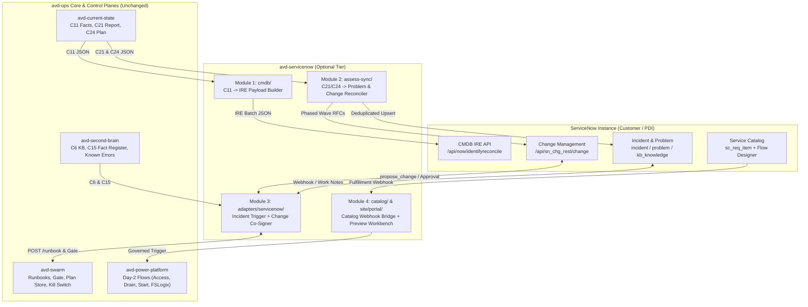

# Spec: `avd-servicenow` — Optional ServiceNow ITSM, CMDB, and Change-Gate Tier

- **Status:** Draft v0.1.0 (Accepted, see [decision ASN-0001](decisions/ASN-0001-servicenow-tier.md)).
- **Date:** 2026-11-09
- **Repository:** `avd-ops/avd-servicenow` (public optional ecosystem tier).
- **Numbering:** Plain decision, lesson, and contract numbers (`decision 0023`, `C11`, `C21`, `C24`) refer to the public [avd-ops](https://avd-ops.dev/) family ([avd-assess](https://github.com/avd-ops/avd-assess), [avd-second-brain](https://github.com/avd-ops/avd-second-brain), [avd-swarm](https://github.com/avd-ops/avd-swarm)). This repository's own decisions are numbered `ASN-NNNN`.
- **Scope:** An opt-in ServiceNow integration tier for the `avd-ops` family. Nothing in the core `avd-ops` repositories requires ServiceNow, and `avd-landing-zone`'s default deployment never changes.

> [!WARNING]
> **Personal project. Research and learning only. Not for production. No warranty.**
>
> This is a personal project built on the author's own time for research and learning. It is **not affiliated with, endorsed by, or supported by the author's employer, ServiceNow, Liquidware, or Microsoft**, and it does not represent their views, products, or guidance. ServiceNow is a registered trademark of ServiceNow, Inc. Provided "as is" under the MIT License.

---

## 1. Summary

In enterprise Azure Virtual Desktop estates, **ServiceNow** is frequently the system of record for Configuration Management (CMDB / CSDM), Incident and Problem Management (ITSM), Change Governance (Change Management), and end-user self-service (Service Catalog).

Under [avd-second-brain decision 0023](https://github.com/avd-ops/avd-second-brain/blob/main/docs/knowledge/decisions/0023-family-format-best-open-source-or-build.md), the `avd-ops` core remains 100% open-source and runnable from a free GitHub account without any standing paid third-party service. `avd-servicenow` adds **ServiceNow as an optional tier and adapter suite** that consumes and emits pinned `avd-ops` contracts without weakening any governance, privacy, or kill-switch control:

| Module | What it connects | Direction | Job |
|---|---|---|---|
| **1. CMDB & CSDM Sync (`cmdb/`)** | `avd-current-state` (`C11`) -> ServiceNow IRE | Outbound | Transforms `C11` (`avd-current-state-facts`) into ServiceNow Identification and Reconciliation Engine (IRE) payloads for host pools, session hosts, app groups, workspaces, and CSDM application services |
| **2. Assessment & Drift Sync (`assess-sync/`)** | `avd-current-state` (`C21`, `C24`) -> ServiceNow Problem & Change | Outbound | Maps `C21` (`avd-assessment-report/v1`) gaps/drift into deduplicated `problem` records (keyed by check ID) and `C24` (`avd-remediation-plan/v1`) waves into phased `change_request` records |
| **3. Swarm Incident & Change Adapter (`adapters/servicenow/`)** | ServiceNow ITSM/Change <-> `avd-swarm` | Bidirectional | **Inbound:** ServiceNow incident triggers a keyless, queue-backed `avd-swarm` runbook (`threadStartedBy: alert`). **Outbound:** Posts verified findings (`C15` citations) to `incident` work notes and mirrors `propose_change` plans into ServiceNow Change requests that trigger the GitHub `approve` workflow upon CAB/Standard approval |
| **4. Day-2 Service Catalog & Workbench (`catalog/`, `site/portal/`)** | ServiceNow Service Catalog <-> `avd-power-platform` & Interactive Portal | Bidirectional | **Catalog:** ServiceNow catalog items for Pool Access, Personal Desktop Start, Host Drain/Restart, and FSLogix Reset backed by `avd-power-platform` fulfillment flows. **Workbench:** Static + local portal (`ds-v2.7.0`) to preview IRE/Change payloads, pull redacted incident context, and draft `kb_template_known_error` articles |

---

## 2. Goals and Non-Goals

### Goals
1. **Contract-first boundary:** Consume existing published contracts (`C6`, `C8`, `C11`, `C15`, `C21`, `C24`) at pinned commits (`PINS.json`) and define one candidate contract (`C26: avd-itsm-sync-envelope/v1`) for deterministic, offline-testable ServiceNow payloads.
2. **Preserve `avd-swarm` safety invariants:** A ServiceNow ticket is untrusted external input (`threadStartedBy: alert`). Prompt-injection scanning (`shield.py`), the `V1-4` evidence provenance rule, the deterministic gate (`governance/policy.yml`), live state-hash verification, and the 4-level kill switch (`halt-actions`, `halt-agents`, `stop-spend`, `halt-all`) apply unchanged.
3. **Zero ticket floods (idempotent correlation):** Every outbound Problem, Incident work-note update, or Change Request carries a deterministic `correlation_id` derived from the estate slug, check/plan ID, and target scope so repeat runs reconcile state instead of opening duplicate tickets.
4. **Keyless authentication first:** Authenticate between Azure/GitHub and ServiceNow using OAuth 2.0 OIDC Workload Identity Federation (Entra ID / GitHub OIDC token exchange against ServiceNow Inbound Federated Credentials) wherever supported; never pass credentials in chat or store secrets in the repo.
5. **100% offline testability:** Every payload builder, IRE mapper, state reconciler, and redaction check is a pure function tested offline with Pester and Node test runners against realistic ServiceNow REST API fixtures.
6. **Public-ready from day one:** Contains zero tenant data, zero references to private repos in its runtime or contracts, and passes the family leak and contract checks on every commit.

### Non-Goals
- **Replacing ServiceNow Discovery or Service Graph Connector for Azure across the entire subscription.** `avd-servicenow` maps the AVD control-plane and session-host estate already collected by `avd-current-state` (`C11`), avoiding duplicate Azure API throttling or heavy MID Server footprint when not needed.
- **Direct unapproved writes from ServiceNow into Azure.** ServiceNow never holds an Azure write credential (`Contributor` / `User Access Administrator`). Fulfillments route through `avd-power-platform` or `avd-swarm`'s governed approval gate.
- **Paid ServiceNow Store plugins as hard dependencies.** All integrations target standard ServiceNow tables (`incident`, `problem`, `change_request`, `sc_req_item`, `kb_knowledge`, `cmdb_ci_*`) and standard REST APIs (`/api/now/table`, `/api/now/identifyreconcile`, `/api/sn_chg_rest`).

---

## 3. Architectural Principles (`SN1-SN9`)

| ID | Principle | Source / Rule |
|---|---|---|
| **SN1** | **Downward contract dependency only.** Core `avd-ops` repos never depend on `avd-servicenow`. While `avd-servicenow` is private, no public repo names or links it. | Family lane rules; [decision 0003](https://github.com/avd-ops/avd-ops/blob/main/docs/knowledge/decisions/0003-the-family-ends-at-its-contracts.md) |
| **SN2** | **Ticket text is untrusted input.** Every string read from ServiceNow (`short_description`, `description`, `comments`, `work_notes`) passes through redaction and Prompt Shields before reaching any model, and carries `threadStartedBy: alert`. | `avd-swarm` V1-4, R26, governance section 2.2 |
| **SN3** | **ServiceNow approval is a co-signature, never a gate bypass.** Approving a `change_request` in ServiceNow may trigger the GitHub `approve` workflow or fulfill a catalog item, but `avd-swarm`'s gate still verifies policy, preconditions (`serviceHealthClear`, drain state), live state hashes, and the kill switch before acquiring a short-lived write token. | `avd-swarm` spec sections 5, 5a |
| **SN4** | **Redaction by default; explicit CMDB opt-in.** Outbound payloads default to pseudonymized identifiers (`<host-1>`, `<pool-1>`, `<sub-1>`) for incident/KB text. Real resource names/ARMs are emitted only in `cmdb/` IRE mode when the operator explicitly passes `-AllowEstateIdentifiers` against their own private ServiceNow instance. | Family privacy rule; `avd-current-state` redaction model |
| **SN5** | **Idempotent `correlation_id` on every record.** No integration ever performs an unkeyed `POST` when a matching active record exists for the same `(estateId, checkId/planId, resourceScope)`. | Anti-flood invariant |
| **SN6** | **Kill switch reaches every ServiceNow path.** At `halt-actions`, change approvals and catalog fulfillments are refused; at `halt-agents`, incident-triggered investigations exit before calling a model; at `halt-all`, inbound queue consumers and outbound sync jobs stop. | `avd-swarm` governance section 2.3 |
| **SN7** | **Keyless Entra / OIDC federation.** No static integration user passwords in scripts or configs. Use Entra Managed Identity / GitHub OIDC token exchange with ServiceNow OAuth 2.0 JWT / OIDC provider, or Key Vault secret references injected at runtime only if an older ServiceNow instance lacks OIDC. | Family security rule |
| **SN8** | **Zero standing Azure spend.** Webhook receivers use Consumption Logic Apps + Azure Storage Queues + scale-to-zero Container Apps Jobs or GitHub Actions workflows (pennies per month, $0 idle). Any live test requires a written cost estimate and `go batch <id> $<total>`. | Family spend rule; [avd-swarm core-and-adapters.md](https://github.com/avd-ops/avd-swarm/blob/main/docs/core-and-adapters.md) |
| **SN9** | **Pure offline transforms.** All mapping logic between `C11`/`C21`/`C24` and ServiceNow JSON payloads runs offline without a live ServiceNow instance. | `avd-current-state` testing rule |

---

## 4. End-to-End Architecture



---

## 5. Module Specifications

### 5.1 Module 1: CMDB & CSDM Sync (`cmdb/`)

Transforms a `C11` (`avd-current-state-facts`) snapshot into deterministic ServiceNow **Identification and Reconciliation Engine (IRE)** payloads (`POST /api/now/identifyreconcile?sysparm_data_source=avd-ops`).

#### CI Class Mapping

| `C11` Entity | Target ServiceNow Class | IRE Identification Key (`criterion_attributes`) | Populated Attributes & Relationships |
|---|---|---|---|
| Estate / Landing Zone Spoke | `cmdb_ci_cloud_service_account` / `cmdb_ci_service_technical` | `object_id` (Subscription + Environment Slug) | CSDM Technical Service root node |
| `hostPools[]` | `cmdb_ci_cloud_host_pool` *(or custom `u_cmdb_ci_avd_host_pool` via Update Set if class absent)* | `object_id` (ARM Resource ID or pseudonymized ID) | `name`, `location`, `host_pool_type` (`Pooled`/`Personal`), `load_balancer_type` (`BreadthFirst`/`DepthFirst`), `max_session_limit`, `validation_environment` |
| `sessionHosts[]` | `cmdb_ci_vm_instance` | `object_id` (VM ARM ID) + `fqdn` | `name`, `os_version`, `vm_size` (SKU), `agent_version`, `status`, `drain_mode`, `Assigned to::Managed by` relationship to Host Pool |
| `applicationGroups[]` | `cmdb_ci_appl` | `object_id` (App Group ARM ID) | `name`, `application_group_type` (`Desktop`/`RemoteApp`), `Depends on::Used by` relationship to Host Pool |
| `workspaces[]` | `cmdb_ci_appl` | `object_id` (Workspace ARM ID) | `name`, `Contains::Contained by` relationship to Application Groups |
| `storageAccounts[]` (FSLogix / App Attach) | `cmdb_ci_cloud_storage_account` | `object_id` (Storage ARM ID) | `name`, `sku`, `identity_type` (`EntraKerberos` / `ADDS`), `Depends on` relationship from Host Pool |

#### Guardrails
- **Default Redacted Preview:** `Build-AvdSnowCmdbPayload` outputs pseudonymized IDs (`<pool-1>`, `<host-1>`) by default so operators can inspect the exact IRE payload in the portal or CI without leaking estate names. Passing `-AllowEstateIdentifiers` enables real ARM resource IDs for live IRE ingestion.
- **No Delete on Missing by Default:** Missing CIs are marked `operational_status = Retired (6)` or `Absent` via IRE reconciliation rules rather than hard-deleted from the CMDB.

---

### 5.2 Module 2: Assessment & Drift Problem/Change Sync (`assess-sync/`)

Consumes `C21` (`avd-assessment-report/v1`) and `C24` (`avd-remediation-plan/v1`) to synchronize architectural drift and remediation waves with ServiceNow Problem and Change Management.

1. **`C21` Gap -> ServiceNow `problem`:**
   - Filters `C21` checks where `status` is `gap` or `drift` and severity meets the configured threshold (default: `high` and `critical`, configurable down to `medium`).
   - Computes a deterministic `correlation_id`: `avd-ops:c21:<estate-slug>:<check-id>` (for example, `avd-ops:c21:contoso-prod:AZ-NET-004`).
   - **Upsert logic:**
     - If no open `problem` with `correlation_id` exists -> creates a `problem` record with `short_description`, structured evidence table (`C15` fact IDs), `avd-assess` claim citations (`ref:`, `gap:`), and affected CMDB CI (`cmdb_ci`) linked from Module 1.
     - If an open `problem` already exists -> updates `work_notes` only if the drift state or affected host count changed since the last snapshot.
     - If a previously open `problem`'s check flips to `pass` in the latest `C21` snapshot -> transitions the `problem` to `Resolved` / `Closed` with the passing `C21` run timestamp and verification hash.
2. **`C24` Wave -> ServiceNow `change_request`:**
   - Maps each remediation wave (`wave-0-foundation`, `wave-1-identity-intune`, `wave-2-azure-avd`, etc.) into a structured ServiceNow Change Request (`normal` or `standard` template).
   - Populates:
     - `justification` and `description`: The `C21` gaps closed by the wave and the target control plane (`avd-azure`, `avd-entra`, `avd-intune`, `avd-m365`, `avd-power-platform`).
     - `implementation_plan`: The exact Bicep / PowerShell / CLI commands or PR link from the `C24` action item.
     - `backout_plan`: The `C24` rollback steps.
     - `test_plan`: The `avd-current-state` verification check IDs that must turn green post-change.

---

### 5.3 Module 3: `avd-swarm` Incident & Change-Gate Adapter (`adapters/servicenow/`)

Implements an `avd-swarm` WP5-compliant adapter manifest (`adapters/servicenow/adapter.yml`):

#### 3a. Inbound Alert / Incident Investigation (`incident: servicenow`)
1. When an AVD incident is opened or assigned to the AVD assignment group in ServiceNow, a lightweight ServiceNow Flow Designer action / Business Rule sends only the **Incident `sys_id`, `number`, symptom category, and affected CI ID** to an Azure Consumption Logic App webhook (authenticated via Entra OAuth).
2. Following `avd-swarm` WP6 (`core-and-adapters.md`), the Logic App places a queue message containing only the reference ID onto the Azure Storage Queue.
3. The `avd-swarm` runner (Container Apps Job or scheduled workflow) reads the queue, checks the kill switch (`halt-agents` / `halt-all`), fetches the ticket fields via a read-only ServiceNow OAuth scope, scrubs untrusted text through redaction and Prompt Shields (`shield.py`), and invokes `POST /runbook` for the matching diagnostic runbook (`hosts.agent-unhealthy`, `storage.fslogix-latency`, etc.) with `threadStartedBy: alert`.
4. **Provenance Enforcement (`V1-4`):** Because `threadStartedBy` is `alert`, `avd-swarm`'s gate (`gate/avd_gate/evidence.py`) guarantees that no write action can execute solely on the ticket's word; the agent must gather fresh, direct Azure control-plane facts (`C15`) and a human must approve any resulting plan.
5. **Work-Note Write-Back:** Once the runbook completes, the runner posts a redacted diagnostic card (outcome: `clear`, `finding`, or `could-not-run`, supported claims, and `C15` citations) back to the ServiceNow Incident's `work_notes`.

#### 3b. Outbound Plan Co-Signing (`propose_change` <-> ServiceNow Change Request)
1. When an `avd-swarm` agent calls `propose_change` (for example, `drain-and-restart-session-host`), the plan is written to `avd-swarm`'s plan store as usual.
2. If the `servicenow` adapter is enabled, `avd-swarm` creates a corresponding ServiceNow Standard or Normal Change Request (`correlation_id: avd-swarm:plan:<plan-id>`) containing the plan's action catalog ID, target host, preconditions, blast radius, and rollback.
3. When a human approver approves the Change Request in ServiceNow (and the change window opens), ServiceNow dispatches the approval event.
4. **Hard Governance Rule (`SN3`):** ServiceNow approval **never** bypasses `avd-swarm`'s gate. The execution job still runs in the protected workflow environment, re-evaluates `governance/policy.yml`, checks the kill switch (`halt-actions`), re-reads live Azure state (`serviceHealthClear: AVD`, active session count, state hash match), and writes the post-action verification outcome (`C10`) back to the ServiceNow Change Request to close it automatically.

---

### 5.4 Module 4: Day-2 Service Catalog & Interactive Workbench (`catalog/` & `site/portal/`)

#### 4a. Day-2 Service Catalog Fulfillment (`catalog/`)
Provides exportable ServiceNow Catalog Item definitions (JSON / Update Set XML) and Flow Designer webhook templates that wire directly into [`avd-power-platform`](https://github.com/avd-ops/avd-power-platform):

| Service Catalog Item | User Input | Approval in ServiceNow | Fulfillment Target in `avd-ops` |
|---|---|---|---|
| **Request AVD Desktop / Pool Access** | Target Workspace / App Group, business justification, duration | Manager / App Owner approval | `avd-power-platform` flow -> `avd-entra` security group assignment |
| **Start Personal Session Host** | Assigned personal desktop CI | Auto-approved for assigned user | `avd-power-platform` start-on-demand flow |
| **Self-Service Session Logoff / Reset** | Active session on hung host | Auto-approved for session owner | `avd-power-platform` user session disconnect/logoff flow |
| **Operator: Drain & Restart Session Host** | Target session host CI, drain timeout | Peer / Change approval | `avd-swarm` `propose_change` or `avd-power-platform` drain flow |

#### 4b. Interactive ServiceNow Bridge Workbench (`site/portal/`)
Built on the `avd-ops` design system (`ds-v2.7.0`) and shared portal engine (`pe-v1.1.0`), running 100% client-side in the browser:
1. **Drop `C11` / `C21` / `C24` / Incident Bundle JSON:** Instantly renders the exact ServiceNow CMDB IRE batch JSON, Problem upsert payloads, and RFC wave records side-by-side with a visual CSDM relationship graph.
2. **Incident Intake & Redaction Inspector:** Paste a raw ServiceNow Incident JSON or description -> see the pseudonymized output, matched diagnostic runbook / playbook, and copyable Cloud Shell / PowerShell commands.
3. **Known Error (`kb_knowledge`) Generator:** Takes a verified incident bundle and emits a ready-to-import ServiceNow Known Error article (`kb_template_known_error`: Symptom, Cause, Resolution, Check IDs) alongside the upstream `avd-second-brain` KB snippet.

---

## 6. Shared Contract Envelope (`C26` Candidate: `avd-itsm-sync-envelope/v1`)

To keep the boundary clean and testable offline, `avd-servicenow` defines `schemas/avd-itsm-sync-envelope.v1.schema.json` (candidate for upstreaming to `avd-assess` as `C26` once `avd-servicenow` launches publicly):

```json
{
  "schema": "avd-itsm-sync-envelope/v1",
  "generatedAt": "2026-11-09T18:00:00Z",
  "estateSlug": "contoso-prod",
  "redactionLevel": "pseudonymized",
  "sourceContracts": {
    "c11Sha256": "e3b0c44298fc1c149afbf4c8996fb92427ae41e4649b934ca495991b7852b855",
    "c21Sha256": "8f434346648f6b96df89dda901c5176b10a6d83961dd3c1ac88b59b2dc327aa4",
    "c24Sha256": "2c26b46b68ffc68ff99b453c1d30413413422d706483bfa0f98a5e886266e7ae"
  },
  "cmdbIreBatch": {
    "items": [],
    "relations": []
  },
  "problems": [
    {
      "correlationId": "avd-ops:c21:contoso-prod:AZ-NET-004",
      "action": "upsert",
      "severity": "high",
      "checkId": "AZ-NET-004",
      "shortDescription": "[AVD Drift] AZ-NET-004: RDP Shortpath UDP 3390 blocked on subnet <subnet-1>",
      "affectedCiId": "<pool-1>",
      "citations": ["ref:ms-shortpath-udp", "gap:AZ-NET-004"]
    }
  ],
  "changeRequests": [],
  "knownErrorDrafts": []
}
```

---

## 7. Authentication & Security Architecture

1. **Outbound (GitHub Actions / Azure Container App -> ServiceNow REST API):**
   - **Preferred (Keyless OIDC):** ServiceNow OAuth 2.0 Inbound Federated Credential (`oauth_entity` + `oidc_provider_configuration`) trusting the estate's Entra ID tenant or GitHub Actions OIDC issuer (`https://token.actions.githubusercontent.com`). The runner exchanges its OIDC JWT for a short-lived ServiceNow access token scoped strictly to the `x_avd_ops.integration` role.
   - **Least-Privilege ServiceNow Role (`x_avd_ops.integration`):**
     - `cmdb/` mode: `cmdb_inst_admin` / IRE import access on AVD CI classes only.
     - `assess-sync/` & `adapters/servicenow/` mode: read/create/write on `incident` (work notes only), `problem`, and `change_request` where `correlation_id STARTSWITH avd-ops:`.
     - Never `admin` or `security_admin`.
2. **Inbound (ServiceNow -> Azure / `avd-swarm`):**
   - ServiceNow Flow Designer / REST Message authenticates via Entra ID OAuth 2.0 client credentials or workload federation against the Consumption Logic App trigger, which writes **only** the ticket `sys_id` and `number` to the Azure Storage Queue (`SN2`, `SN8`).

---

## 8. Repository Layout (`avd-servicenow`)

```text
avd-servicenow/
├── AGENTS.md                           # AI agent instructions & family rules
├── CLAUDE.md                           # Imports AGENTS.md + repo checks
├── GEMINI.md                           # Imports AGENTS.md
├── README.md                           # Overview, architecture, and disclaimer
├── LICENSE                             # MIT License
├── PINS.json                           # Pinned commits for avd-assess, avd-current-state, avd-swarm
├── docs/
│   ├── spec.md                         # This specification
│   ├── guardrails.md                   # Privacy, redaction, and OIDC guardrails
│   └── decisions/
│       └── ASN-0001-servicenow-tier.md # ADR for the optional ServiceNow tier
├── schemas/
│   └── avd-itsm-sync-envelope.v1.schema.json
├── adapters/
│   └── servicenow/
│       └── adapter.yml                 # avd-swarm WP5-compliant adapter manifest (default: off)
├── scripts/
│   ├── AvdServiceNow.psm1              # Pure PowerShell functions (Phase 1)
│   ├── Invoke-AvdServiceNowSync.ps1    # CLI entry point (Phase 1)
│   └── servicenow-core.js              # Pure JS UMD engine for IRE/Problem/Change/Redaction (Phase 1)
├── site/
│   └── portal/                         # Interactive ServiceNow Bridge & CSDM Preview Workbench (Phase 2)
└── tests/
    └── bootstrap.test.mjs              # Schema, adapter, and leak checks
```

---

## 9. Verification & CI Checks

Every pull request in `avd-servicenow` runs 100% offline in CI (`.github/workflows/ci.yml`):

```bash
node --test "tests/*.test.mjs"
```

Required automated guards in `tests/`:
1. **Leak & Redaction Guard:** Fails if any file or emitted payload (without `-AllowEstateIdentifiers`) contains an unredacted GUID, subscription ID, ServiceNow instance URL (`*.service-now.com` other than `contoso.service-now.com`), UPN, IPv4 address, or real hostname.
2. **Idempotency Guard:** Running the sync envelope builder twice against the same `C11`/`C21`/`C24` fixture produces identical `correlation_id` values and zero duplicate ticket actions.
3. **Untrusted Input Guard (`V1-4`):** Verifies that any `avd-swarm` runbook request generated from a ServiceNow incident carries `threadStartedBy: alert` and passes through redaction.
4. **Adapter Schema Guard:** Validates `adapters/servicenow/adapter.yml` against `avd-swarm`'s WP5 adapter rules (`default: off`, `writes: none`, `replaces: []`, `exitTests: []`).

---

## 10. Phased Build Plan

| Phase | Deliverable | Proving Check | Spend |
|---|---|---|---|
| **Phase 0: Spec & Repo Bootstrap** | `AGENTS.md`, `CLAUDE.md`, `GEMINI.md`, `README.md`, `docs/spec.md`, `docs/guardrails.md`, `docs/decisions/ASN-0001-servicenow-tier.md`, `schemas/avd-itsm-sync-envelope.v1.schema.json`, `adapters/servicenow/adapter.yml`, `tests/bootstrap.test.mjs` | `node --test "tests/*.test.mjs"` green | $0 (offline) |
| **Phase 1: Core Engine & Offline Tests** | `scripts/AvdServiceNow.psm1`, `scripts/servicenow-core.js`, synthetic `C11`/`C21`/`C24` fixtures, Pester + Node unit tests | `Invoke-Pester` and `node --test` 100% green | $0 (offline) |
| **Phase 2: Interactive Bridge Portal** | `site/portal/` (`ds-v2.7.0` + `pe-v1.1.0`): drop `C11`/`C21`/`C24` or raw `INC` JSON -> preview IRE batch, CSDM graph, Problem/Change payloads, and Known Error drafts | `node --test "tests/portal.test.mjs"` green | $0 (offline) |
| **Phase 3: PDI Verification** | Optional live test against a free ServiceNow Personal Developer Instance (PDI) using synthetic `contoso` fixtures | IRE ingestion + Problem upsert + Change state transition verified | $0 (free PDI, requires owner's go) |
| **Phase 4: Public Launch Readiness** | Open-source under `avd-ops/avd-servicenow`, relax the partner rule across public `avd-ops` repos, promote `C26` to `avd-assess`, and register `adapters/servicenow` in `avd-swarm` | Family contract & pin checks green across repos | $0 (offline) |
